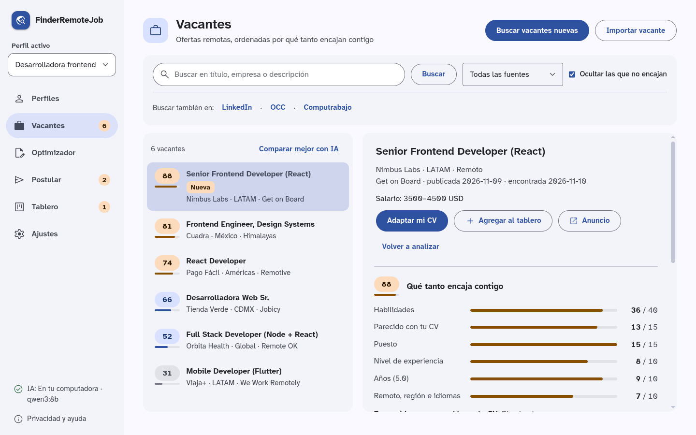
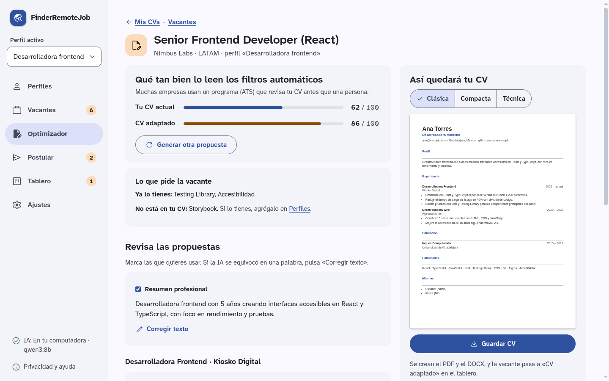
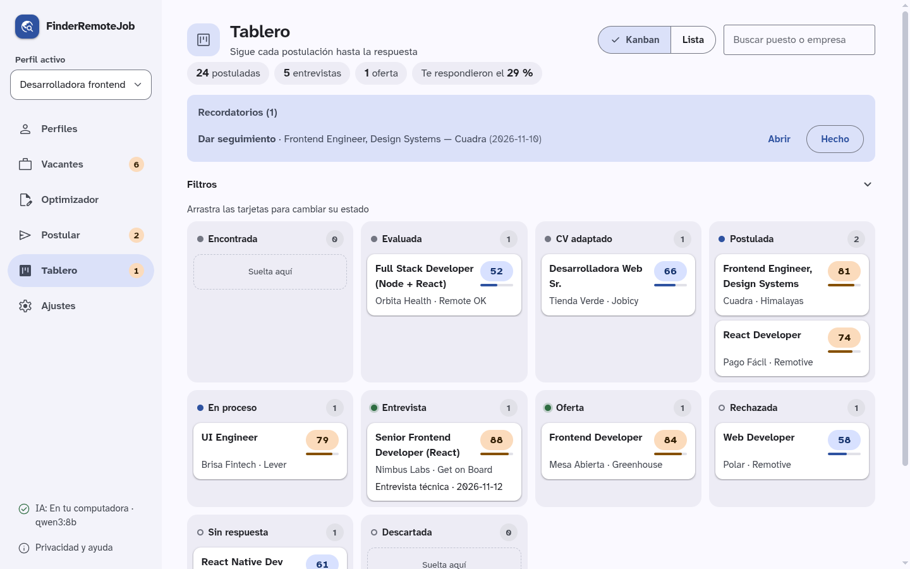
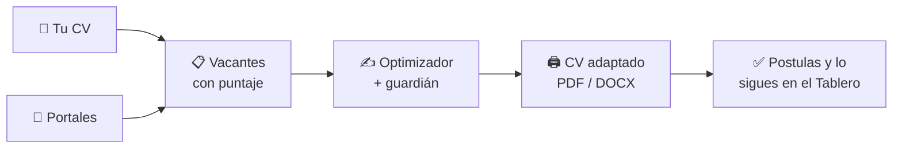

<p align="center">
  
</p>

<h1 align="center">FinderRemoteJob</h1>

<p align="center"><strong>Encuentra empleo remoto, adapta tu CV sin inventar nada y lleva el control de tus postulaciones.</strong></p>

<p align="center">
  <a href="https://github.com/Freecssless/FinderRemoteJob/actions/workflows/pruebas.yml"></a>
  <a href="#licencia"></a>
  
  
  
</p>

<p align="center">
  <a href="#instalación">Instalar</a> ·
  <a href="#cómo-se-usa">Cómo se usa</a> ·
  <a href="#preguntas-frecuentes">Preguntas frecuentes</a> ·
  <a href="PRIVACIDAD.md">Privacidad</a> ·
  <a href="https://github.com/Freecssless/FinderRemoteJob/issues">Reportar un problema</a>
</p>

<br>

<p align="center">
  Mandar CVs y no recibir respuesta cansa.<br>
  <strong>Casi siempre el CV no pasó el filtro automático (ATS).</strong>
</p>

<p align="center">
  FinderRemoteJob junta vacantes remotas para México y Latinoamérica, te dice cuáles te quedan<br>
  y adapta tu CV a cada una <strong>usando solo lo que tú ya hiciste</strong>.
</p>

<p align="center">
  Todo pasa en tu computadora. <strong>Tú decides y tú le das «Enviar».</strong>
</p>

<p align="center">
  <picture>
    <source media="(prefers-color-scheme: dark)" srcset="docs/capturas/vacantes-oscuro.png">
    
  </picture>
</p>

<p align="center"><sub>Vacantes ordenadas por qué tanto encajan contigo. Los datos de las capturas son ficticios.</sub></p>

<br>

## Qué hace por ti

- **¿Dónde busco?** Junta vacantes remotas de varios portales en una sola lista, sin duplicados.
- **¿Me conviene?** Le pone a cada vacante un puntaje de compatibilidad con tu CV, del 0 al 100.
- **¿Pasará el filtro?** Mide tu CV como lo haría un ATS, te enseña qué palabras clave te faltan y te propone mejoras.
- **¿Cómo lo mando?** Genera el CV adaptado en PDF y DOCX, listo para enviar.
- **¿A quién le escribí?** Un tablero tipo Kanban guarda cada postulación, su estado y el CV que mandaste.
- **¿Cuándo doy seguimiento?** Te avisa cuando toca escribir otra vez o cuando una vacante lleva días sin respuesta.

## Lo que nunca hará

> [!IMPORTANT]
> - **Inventar datos.** Un «guardián» revisa cada propuesta y bloquea cifras, empresas o habilidades que no estén en tu CV.
> - **Postularse por ti.** Te prepara todo, pero el botón de enviar siempre lo presionas tú.
> - **Subir tus datos a un servidor nuestro.** No hay cuentas, ni servidor, ni telemetría.
> - **Mandar tu nombre, correo o teléfono a una IA externa.** Si eliges una IA en internet, antes se le quitan tus datos personales y te pide permiso.

## Funciones

| | Función | Qué hace |
|---|---|---|
| 👤 | **Varios perfiles** | Un perfil por cada tipo de trabajo que buscas (ej. «Editor de video» y «Diseñador»), cada uno con su CV maestro. |
| 📄 | **Importa tu CV** | Lee tu CV en PDF o DOCX y lo convierte en un formulario que puedes revisar y corregir. |
| 🔎 | **Buscador de vacantes** | Remote OK, Remotive, We Work Remotely, Get on Board, Jobicy, Himalayas y empresas en Greenhouse, Lever o Ashby. |
| 🎯 | **Compatibilidad** | Compara tus habilidades, experiencia, idiomas y preferencias con cada vacante, y te explica el puntaje. |
| ✍️ | **Optimizador de CV** | Puntaje ATS antes y después, palabras clave que faltan y cambios que aceptas o rechazas uno por uno. |
| 🖨️ | **PDF y DOCX** | Tres plantillas (Clásica, Compacta y Técnica) que los ATS leen bien. |
| 📋 | **Tablero** | Kanban con arrastrar y soltar, historial de estados, notas y recordatorios. |

<details>
<summary><b>Y además…</b></summary>

| Función | Qué hace |
|---|---|
| **Cola de postulación** | Te guía vacante por vacante y guarda tus respuestas frecuentes para copiarlas. |
| **Importación manual** | Pega el enlace o el texto de cualquier vacante (LinkedIn, OCC, Computrabajo…) y la analiza igual. |
| **Similitud semántica** | Entiende que «Premiere» y «edición de video» se relacionan, no solo palabras exactas. |
| **Compatibilidad a tu medida** | Con 30 postulaciones con resultado, te sugiere qué pesar más según lo que sí te funcionó. |
| **Copia de seguridad** | Guarda todo en un `.zip` y lo restaura con un clic. |
| **Tema claro y oscuro** | Sigue el de tu sistema. Se usa con teclado y tiene una tipografía pensada para leer fácil. |

</details>

## Así se ve

**Optimizador:** tu puntaje ATS antes y después, lo que pide la vacante y cómo quedará tu CV.

<p align="center">
  <picture>
    <source media="(prefers-color-scheme: dark)" srcset="docs/capturas/optimizador-oscuro.png">
    
  </picture>
</p>

**Tablero:** cada postulación en su columna, con recordatorios y tu tasa de respuesta.

<p align="center">
  <picture>
    <source media="(prefers-color-scheme: dark)" srcset="docs/capturas/tablero-oscuro.png">
    
  </picture>
</p>

## Cómo funciona



## Instalación

1. Ve a [**Releases**](https://github.com/Freecssless/FinderRemoteJob/releases) y descarga el instalador de tu sistema:

   | Sistema | Archivo |
   |---|---|
   | Windows | `.exe` o `.msi` |
   | Ubuntu / Debian | `.deb` |
   | Fedora / openSUSE | `.rpm` |
   | Cualquier Linux | `.AppImage` |

2. Ábrelo e instala.
3. La primera vez, el asistente de bienvenida te ayuda a instalar la **IA local gratuita** ([Ollama](https://ollama.com)) y a descargar sus modelos. En Windows lo hace desde la misma app.

> [!NOTE]
> Los instaladores no están firmados. Windows mostrará «Windows protegió su PC»: haz clic en **Más información → Ejecutar de todas formas**.

## Cómo se usa

1. **Crea tu perfil** e importa tu CV. Revisa lo que leyó y corrige lo que haga falta.
2. **Ve a Vacantes** y pulsa «Buscar». Las verás ordenadas por compatibilidad.
3. **Abre una vacante** que te guste y mándala al **Optimizador**.
4. **Acepta o rechaza** cada cambio propuesto y descarga tu CV en PDF o DOCX.
5. **Postúlate** en el portal y registra la postulación. Aparecerá en el **Tablero**.

## Privacidad

Tus datos viven solo en tu computadora, en una carpeta que solo tú puedes abrir.

| Si usas… | Qué sale de tu equipo |
|---|---|
| **IA local (Ollama)**, la opción por defecto | Nada. Todo se procesa en tu computadora. |
| **IA externa** (Claude, Gemini o ChatGPT, con tu propia clave) | Solo el texto de tu CV **sin** nombre, correo, teléfono ni educación, y solo si das permiso. |

Las claves de API se guardan en el llavero de tu sistema, no en archivos. En **Privacidad y ayuda** puedes borrar todos tus datos con un botón. Todos los detalles están en la [política de privacidad](PRIVACIDAD.md).

## Fuentes de vacantes

Solo usamos portales con **API o RSS oficial**, y cada vacante enlaza a su anuncio original con su fuente, como piden sus términos.

LinkedIn, Indeed, Glassdoor, OCC y Computrabajo **no** se consultan automáticamente: sus términos lo prohíben y podrías perder tu cuenta. Puedes pegar el enlace o el texto de esas vacantes a mano.

## Preguntas frecuentes

<details>
<summary><b>¿Es gratis?</b></summary>

Sí. La app es de código abierto y la IA local es gratuita. Solo pagarías si decides usar una IA externa con tu propia clave.
</details>

<details>
<summary><b>¿Qué computadora necesito?</b></summary>

Cualquiera con Windows o Linux sirve para la app. Para que la IA local vaya fluida se recomiendan unos 16 GB de RAM o una tarjeta gráfica con 8 GB o más; sin tarjeta gráfica puede tardar unos minutos en adaptar un CV. La primera vez descarga unos 8 GB (Ollama y sus modelos).
</details>

<details>
<summary><b>¿La IA puede poner cosas falsas en mi CV?</b></summary>

No debería: el guardián bloquea números, empresas y habilidades que no estén en tu CV maestro. Aun así, **lee siempre tu CV antes de enviarlo**, porque una reformulación puede cambiar el matiz de algo.
</details>

<details>
<summary><b>¿Hay versión para celular o Mac?</b></summary>

Todavía no. Android está planeado; Mac e iOS más adelante.
</details>

<details>
<summary><b>Encontré un error, ¿qué hago?</b></summary>

En la app, ve a **Privacidad y ayuda → Reportar un problema**, o abre un [issue](https://github.com/Freecssless/FinderRemoteJob/issues). Los reportes son públicos: no pegues tu CV ni datos personales.
</details>

## Para desarrolladores

<details>
<summary><b>Estructura del proyecto</b></summary>

| Carpeta | Paquete | Qué contiene |
|---|---|---|
| `crates/core` | `finder-core` | Dominio puro: modelos, ATS, compatibilidad, guardián. **Sin IO**, para reusarlo en móvil |
| `crates/infra` | `finder-infra` | SQLite, clientes de IA, fuentes de vacantes, PDF/DOCX |
| `src-tauri` | `finder-app` | App de escritorio Tauri 2: comandos delgados sobre `finder-infra` |
| `src` | — | Interfaz SvelteKit 5 + TypeScript (`adapter-static`) |

El diseño completo está en [`docs/ARQUITECTURA.md`](docs/ARQUITECTURA.md) y los cambios en [`CHANGELOG.md`](CHANGELOG.md).
</details>

<details>
<summary><b>Compilar y probar</b></summary>

Requisitos: Rust estable 1.85 o posterior y Node.js. En Arch/CachyOS:

```bash
sudo pacman -S --needed webkit2gtk-4.1 base-devel curl wget file openssl \
  appmenu-gtk-module libappindicator-gtk3 librsvg xdotool nodejs npm
```

```bash
cargo test                    # pruebas de Rust
cargo clippy --all-targets    # lint
npm install
npm run tauri dev             # app con recarga en caliente
npm run check                 # tipos de la interfaz
```

- La base de datos está en `~/.local/share/com.finderremotejob.app/finder.db` (Linux).
- Si la ventana sale en blanco en Linux: `WEBKIT_DISABLE_DMABUF_RENDERER=1 npm run tauri dev`.
</details>

<details>
<summary><b>IA y claves de API</b></summary>

| Papel | Para qué | Por defecto |
|---|---|---|
| **Local** | Importar el CV, clasificar requisitos, similitud semántica | Ollama con `qwen3:8b` y `bge-m3` |
| **Redactor** | Reescribir el CV | El modelo local, o Claude / Gemini / ChatGPT si lo eliges en Ajustes |

```bash
ollama pull qwen3:8b
ollama pull bge-m3
cargo test -p finder-infra llm -- --ignored --nocapture   # prueba en vivo
```

Las claves nunca van en el código. Para desarrollo, copia `.env.example` como `.env` (está excluido de git); ahí están todas las variables documentadas.
</details>

<details>
<summary><b>Generar instaladores</b></summary>

- **Linux, en tu equipo:** `npm run tauri build -- --bundles deb,rpm,appimage` (quedan en `target/release/bundle/`).
- **Windows y Linux en GitHub:** sube una etiqueta (`git tag v0.1.0 && git push --tags`). El flujo `release.yml` crea un borrador de versión con los instaladores.
</details>

## Licencia

Código bajo [MIT](LICENSE-MIT) o [Apache 2.0](LICENSE-APACHE), a tu elección. Al usar la app aceptas los [términos de uso](TERMINOS.md). Las licencias de fuentes, iconos y dependencias están en [LICENCIAS-TERCEROS.md](LICENCIAS-TERCEROS.md).

<p align="center"><sub>Si FinderRemoteJob te ayudó, una ⭐ ayuda a que otra persona lo encuentre.</sub></p>
