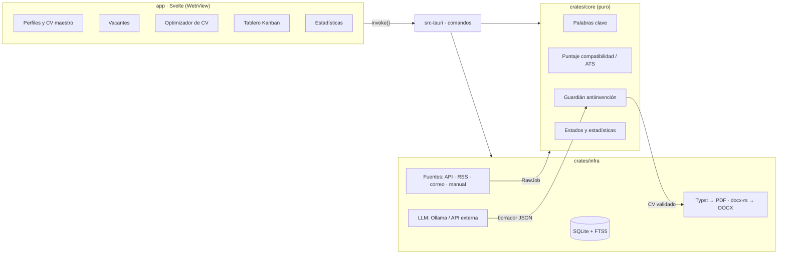
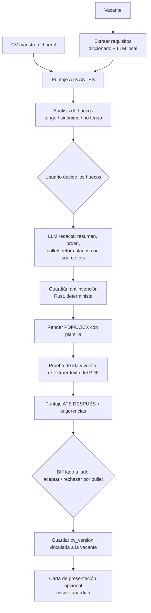

# FinderRemoteJob: arquitectura y plan

> Decisiones base: **IA híbrida** (Ollama local + API externa opcional con tu propia clave), **Tauri 2 + Svelte/TypeScript**, **uso personal primero** (código abierto quizá después).
> Desarrollo previsto para una sola persona, con unas 15–20 h por semana.

---

## 0. Principios que guían todo el diseño

1. **El CV maestro es un dato estructurado, no un archivo.** Cada experiencia, logro y habilidad tiene un `id`. Así la IA puede reformular sin inventar: todo lo que genera debe apuntar a un `id` existente.
2. **La IA propone y Rust valida.** Las puntuaciones, los filtros y el control de lo que se inventa son código determinista y probado. El LLM solo extrae requisitos y redacta.
3. **No se automatiza nada que ponga en riesgo tus cuentas.** Se consume lo que los portales ofrecen (API, RSS, alertas por correo) y lo demás se importa a mano en un clic. La postulación siempre la confirma una persona.
4. **Toda la lógica vive en crates de Rust sin interfaz.** El móvil reutiliza el 100 % del núcleo, y la interfaz es una capa delgada.

---

## 1. Arquitectura

### Capas

| Capa | Crate | Responsabilidad | Hace IO |
|---|---|---|---|
| Presentación | `app/` (Svelte + TS) | Pantallas: Perfiles, Vacantes, Optimizador, Tablero, Estadísticas | No (llama a `invoke`) |
| Puente | `src-tauri` | Comandos Tauri delgados, estado de la app, notificaciones y apertura de enlaces | Sí |
| Dominio | `crates/core` | Modelos, extracción de palabras clave, puntajes ATS y de compatibilidad, guardián antiinvención, máquina de estados y estadísticas | **No** (funciones puras, 100 % testeables) |
| Infraestructura | `crates/infra` | SQLite, clientes LLM, fuentes de vacantes, generación de PDF y DOCX | Sí |

### Diagrama



### Flujo de datos principal

```
Fuente (API/RSS/correo/manual)
  → normalizar (RawJob → Job) → deduplicar (hash de empresa+puesto+ubicación normalizados)
  → extraer requisitos (diccionario + LLM local, JSON)
  → puntaje de compatibilidad por perfil          [Encontrada → Evaluada]
  → usuario elige → optimizador de CV → guardián → revisión con diff
  → render PDF/DOCX + carta                        [CV adaptado]
  → cola de postulación asistida → abre el portal en el navegador → "Ya me postulé"  [Postulada]
  → recordatorios → cambios de estado → estadísticas
```

---

## 2. Stack tecnológico

### Comparativa de frameworks de interfaz

| Criterio | **Tauri 2** | Dioxus (0.6/0.7) | Slint |
|---|---|---|---|
| Lenguaje de la interfaz | HTML/CSS/TS (cualquier framework web) | Rust (RSX, parecido a React) | DSL `.slint` + Rust |
| Android / iOS | **Estable** desde la 2.0 (oct 2024) | Funciona, pero sigue madurando | Android sí; iOS más reciente |
| Componentes listos (Kanban con arrastrar, gráficas, editor rico, vista previa de PDF) | **Ecosistema web completo** | Pocos; tendrías que construirlos | Pocos; widgets propios |
| Interfaz "muy intuitiva" para no técnicos | **Lo más rápido de pulir** | Posible, pero más lento | Bien para apps de formulario, limitada para tableros |
| Tamaño del binario | Pequeño (usa el WebView del sistema) | Pequeño | Muy pequeño |
| Licencia | MIT/Apache | MIT/Apache | GPLv3, gratuita con atribución o comercial |
| Riesgo | WebKitGTK en Linux a veces difiere de Chrome | API todavía cambiante | DSL propio que hay que aprender |

**Recomendación: Tauri 2 + Svelte 5 (SvelteKit con `adapter-static`) + TypeScript.**
- Sabes algo de web, y Svelte es el framework con menos código repetitivo (ideal para una sola persona).
- Tienes librerías listas para lo difícil de la interfaz: `svelte-dnd-action` (Kanban), `layerchart` o `chart.js` (estadísticas) y `shadcn-svelte` (componentes accesibles).
- La lógica pesada sigue en Rust, así que la "reescritura" para móvil se limita a hacer la interfaz responsive.

### Crates recomendados

| Área | Crate | Por qué |
|---|---|---|
| App | `tauri` 2, `tauri-plugin-notification`, `tauri-plugin-opener`, `tauri-plugin-dialog`, `tauri-plugin-clipboard-manager` | Recordatorios, abrir vacantes en el navegador, elegir archivos y copiar respuestas |
| Async / HTTP | `tokio`, `reqwest` (feature `rustls-tls`, `json`) | Estándar de facto; rustls evita depender de OpenSSL en móvil |
| Serialización | `serde`, `serde_json` | Todo: API, LLM, CV maestro |
| BD | `sqlx` (feature `sqlite`, `runtime-tokio`, `migrate`) | Asíncrono, migraciones incluidas, funciona en Android/iOS |
| Búsqueda local | SQLite **FTS5** (incluido) | Búsqueda de texto completo en vacantes sin otro motor |
| RSS | `feed-rs` | Lee RSS y Atom (We Work Remotely, Jobicy) |
| HTML | `scraper` | Solo para extraer texto de una página que **tú** abres e importas |
| Correo (fase 2) | `async-imap` + `mail-parser` | Leer *tus* alertas de empleo (LinkedIn, Indeed, OCC, Computrabajo) |
| Texto | `unicode-normalization`, `deunicode`, `unicode-segmentation`, `rust-stemmers` (es/en), `aho-corasick`, `strsim`, `whatlang` | Normalizar acentos, tokenizar, buscar miles de habilidades en microsegundos, similitud aproximada y detectar el idioma de la vacante |
| Lectura de CV | `pdf-extract`, `docx-rs` (lee y escribe) | Importar el CV actual y hacer la prueba de ida y vuelta ATS |
| PDF | `typst` vía `typst-as-lib` + `typst-pdf` | Plantillas de texto declarativas, PDF con texto real y seleccionable, en una sola columna y con fuentes incrustadas |
| DOCX | `docx-rs` | Usa estilos nativos (`Heading1`, `ListBullet`) que los ATS entienden |
| Secretos | `keyring` | Guarda las claves de API en el llavero del sistema, no en SQLite |
| Errores / logs | `thiserror` (core), `anyhow` (app), `tracing` | Lo usual |
| Fechas / IDs | `time` o `chrono`, `uuid` (v7, ordenable) | — |
| Correo saliente (opcional) | `lettre` | Para vacantes que piden "envía tu CV a…", siempre con confirmación |

### Integración de IA (híbrida)

Una sola interfaz en `infra::llm`:

```rust
pub trait Llm: Send + Sync {
    async fn complete_json(&self, system: &str, user: &str, schema: &serde_json::Value)
        -> Result<serde_json::Value, LlmError>;
    async fn embed(&self, texts: &[String]) -> Result<Vec<Vec<f32>>, LlmError>;
}
```

Bastan **dos implementaciones**:
1. **Compatible con OpenAI** (`/v1/chat/completions`): cubre **Ollama** (local), OpenAI, Gemini, Groq y OpenRouter con el mismo código.
2. **Anthropic nativa** (Messages API): para usar Claude. Usa *tool use* o salida estructurada para forzar el JSON.

| Tarea | Por defecto | Por qué |
|---|---|---|
| Extraer requisitos de una vacante (JSON) | **Local** (Ollama, modelo de 7–12B tipo Qwen o Gemma, el vigente) | Se hace cientos de veces, el texto es público y cuesta 0 |
| Embeddings para similitud semántica | **Local** (`bge-m3`, multilingüe) | Gratis y rápido |
| Reescribir el CV y la carta | **API externa** si hay clave; si no, local | Es donde más se nota la calidad en español; son pocas llamadas |

| | Local (Ollama) | API externa |
|---|---|---|
| Costo | $0 (luz y hardware) | Pago por uso. Una adaptación de CV ≈ 4–6 k tokens de entrada + 1.5–2 k de salida, es decir, centavos de dólar con modelos pequeños o medianos. La app debe mostrar el costo estimado antes de cada llamada |
| Privacidad | Nada sale del equipo | El CV llega al proveedor. **Mitigación:** antes de enviarlo, sustituir nombre, correo, teléfono, dirección y URLs por marcadores (`{{NOMBRE}}`), que se restauran al generar el documento. Ojo: algunos niveles gratuitos usan tus datos para entrenar |
| Hardware | ~16 GB de RAM o GPU con 8 GB o más para que sea fluido | Ninguno |
| Móvil | No es viable en el teléfono; usar la API o el Ollama del escritorio por LAN | Igual que en escritorio |

---

## 3. Portales

Leyenda: **API** = oficial y documentada · **RSS** = feed público · **Correo** = alertas que te llegan a ti · **Manual** = pegas la URL o el texto y la app lo procesa (una sola petición, iniciada por ti, igual que tu navegador).

### Los que ya usas

| Portal | API oficial | RSS | Scraping | Riesgo legal / ToS | Método recomendado | Prioridad |
|---|---|---|---|---|---|---|
| **LinkedIn** | No (solo socios) | No | **Prohibido** (Acuerdo de Usuario §8.2; hiQ vs LinkedIn terminó a favor de LinkedIn por incumplimiento de contrato). Detecta automatización y **restringe cuentas** | Muy alto | Alertas por correo + importación manual. Nada de "Easy Apply" automatizado | Alta (por volumen), solo pasivo |
| **Indeed** | La Publisher API dejó de aceptar registros nuevos; las APIs actuales son para ATS | Los RSS públicos fueron retirados | **Prohibido** y con fuerte antibot | Alto | Alertas por correo + manual | Alta, solo pasivo |
| **Glassdoor** | API cerrada | No | Prohibido | Alto | Manual. Úsalo para *investigar empresas*, no como fuente | Baja |
| **OCC Mundial** | No pública | No | ToS lo restringe; protección antibot moderada | Medio | Alertas por correo + manual | **Alta (México)** |

### Recomendados (México, LATAM y remoto)

| Portal | Acceso | Riesgo | Notas | Prioridad |
|---|---|---|---|---|
| **Get on Board** | **API pública** | Bajo | Tecnología en LATAM, muchas vacantes remotas y salarios visibles | **MVP** |
| **Remote OK** | **API JSON** (`/api`) | Bajo | Exige atribución (enlace y mención) | **MVP** |
| **We Work Remotely** | **RSS** por categoría | Bajo | Filtrar "Anywhere" / LATAM | **MVP** |
| **Remotive** | **API pública** | Bajo | Piden pocas llamadas al día y atribución. Guardar en caché | **MVP** |
| **Jobicy** | **API/RSS** con filtro geográfico (LATAM, México) | Bajo | Muy útil para tu enfoque | **MVP** |
| **Himalayas** | **API pública** | Bajo | Remoto global, filtra por país permitido | Fase 2 |
| **Torre** (torre.ai) | API JSON no documentada formalmente (la que usa su web) | Medio | Fuerte en LATAM y remoto. Revisa sus ToS y usa poco volumen | Fase 2 |
| **Adzuna** | **API oficial** (clave gratis) con México | Bajo | Agregador; trae vacantes de muchos portales mexicanos | Fase 2 |
| **Jooble** | **API oficial** (clave por solicitud) con México | Bajo | Agregador | Fase 2 |
| **Greenhouse / Lever / Ashby / Workable** | **APIs públicas de bolsas de empleo** por empresa (p. ej. `boards-api.greenhouse.io/v1/boards/{empresa}/jobs`) | Bajo | Mantén una lista de empresas remote-first que contratan en LATAM. Son vacantes directas, sin intermediarios | Fase 2 |
| **Computrabajo** | Sin API | Medio | Muy fuerte en México y LATAM. Alertas por correo + manual | Alta (manual) |
| **Bumeran** | Sin API | Medio | México y Argentina. Alertas + manual | Media |
| **Hireline** (MX, tecnología), **Workana** (freelance LATAM) | Sin API | Medio | Manual | Baja |

**Regla de oro en el código:** cada fuente declara `access: Api | Rss | Email | Manual`. **No existe una implementación de scraping masivo** para LinkedIn, Indeed, Glassdoor ni OCC. Si algún día lo consideras, es una decisión consciente y no un "modo" escondido.

### Postulación asistida (para "postularte a la mayor cantidad posible" sin arriesgar cuentas)

1. **Cola diaria:** la app propone las N vacantes con compatibilidad ≥ 70 que aún no tienen postulación.
2. Por cada una genera el CV adaptado, la carta y las respuestas a preguntas frecuentes (salario esperado, disponibilidad, años con X), tomadas de tu perfil.
3. Botón **"Abrir y postular"**: abre la vacante en tu navegador, copia la carta al portapapeles y deja el PDF listo para arrastrar.
4. Tú envías la solicitud y pulsas **"Ya me postulé"**. La app registra la fecha y la versión del CV, y programa el recordatorio.
5. Si la vacante pide postular por correo: borrador con `lettre`, que **se envía solo cuando lo confirmas**.

Así te postulas en 1–2 minutos por vacante, frente a 10–15 haciéndolo a mano, y sin ningún bot dentro de tus cuentas.

---

## 4. Módulo de optimización de CV (el núcleo)

### 4.1 CV maestro (fuente de la verdad)

Se guarda por perfil como JSON (inspirado en el esquema *JSON Resume*), con un `id` en cada pieza:

```json
{
  "basics": { "name": "…", "email": "…", "headline": "Editor de video", "location": "CDMX", "links": [] },
  "experience": [{
    "id": "exp_01", "company": "Productora X", "title": "Editor de video", "start": "2022-01", "end": null,
    "bullets": [
      { "id": "b_01", "text": "Edité 120 videos para YouTube con Premiere y After Effects", "metrics": ["120"] }
    ]
  }],
  "skills": [{ "id": "sk_01", "name": "Adobe Premiere Pro", "level": "avanzado", "years": 4 }],
  "education": [], "certifications": [], "languages": [{ "name": "Inglés", "level": "B2" }]
}
```

- **Importación:** subes tu PDF o DOCX → `pdf-extract` / `docx-rs` → el LLM lo convierte a este JSON → **tú lo revisas y confirmas** en un formulario. Nada entra al maestro sin tu confirmación.
- Cada perfil ("Editor de video", "Programador Jr.") tiene su propio maestro y puede **heredar** piezas comunes (educación, idiomas).

### 4.2 Flujo



### 4.3 Extracción de palabras clave (`core::ats::keywords`)

1. **Normalizar:** minúsculas y sin acentos *para comparar*, pero se conserva la forma original (`surface`) para escribir.
2. **Diccionario de habilidades:** **ESCO** (catálogo europeo gratuito, en español e inglés) + una lista técnica propia (lenguajes, frameworks, software creativo) + **sinónimos** (`JS ↔ JavaScript`, `Premiere ↔ Adobe Premiere Pro`, `React.js ↔ React`). Se busca con `aho-corasick`, en microsegundos, sin red.
3. **LLM local con esquema JSON** para clasificar *requerido vs. deseable*, detectar seniority, años mínimos, idiomas, restricciones geográficas ("US only", "LATAM") y términos fuera del diccionario. Los términos nuevos se agregan al diccionario cuando tú los confirmas.
4. **Pesos:** requerido = 3 · deseable = 1 · aparece en el título del puesto = +2 · repetido en el anuncio = +log(frecuencia).

```rust
pub struct Term { pub surface: String, pub canonical: String, pub kind: TermKind, pub required: bool, pub weight: f32 }
```

### 4.4 Puntajes

**A) Compatibilidad perfil ↔ vacante (para ordenar), 0–100**

| Componente | Peso | Cálculo |
|---|---|---|
| Habilidades técnicas | 45 | Cobertura ponderada de los `Term` contra *todo* el maestro |
| Similitud semántica | 15 | Coseno entre los embeddings del maestro y de la vacante, reescalado |
| Puesto y seniority | 15 | `strsim` entre el titular o los puestos previos y el título de la vacante, más el nivel |
| Años de experiencia | 10 | min(1, años_tuyos / años_pedidos) |
| Logística | 15 | Remoto o LATAM elegible, idioma, zona horaria y salario si se conoce |
| **Bloqueantes** | tope 20 | "US only", ciudadanía, idioma que no hablas → se marca en rojo |

Es honesto llamarlo *compatibilidad*, no *probabilidad*. En la fase 2, cuando tengas 30 o más postulaciones con resultado, se reajustan los pesos con tus propios datos (qué tan bien predijo cada componente una respuesta).

**B) Puntaje ATS de un documento concreto, 0–100 (antes y después)**

| Componente | Peso | Cálculo |
|---|---|---|
| Palabras clave | 60 | Σ wₖ·hitₖ / Σ wₖ, con hit = **1.0** si aparece la forma *exacta* del anuncio, **0.7** si solo coincide un sinónimo o la forma canónica, 0 si falta |
| Título | 10 | Alineación entre el titular del CV y el puesto |
| Secciones y contacto | 10 | Encabezados estándar presentes; correo, teléfono, ubicación y LinkedIn en el cuerpo (no en el encabezado de página) |
| Legibilidad | 20 | **Prueba de ida y vuelta:** se renderiza el PDF, se vuelve a extraer el texto con `pdf-extract` y se verifica que las secciones aparezcan en orden, sin caracteres rotos y con todas las palabras clave recuperables. Penaliza más de 2 páginas y formatos de fecha inconsistentes |

- **"Antes"** = el texto de tu CV original (si lo subiste) o el maestro con la plantilla base.
- **Salida para la interfaz:** puntaje antes → después, palabras clave faltantes divididas en *"tienes evidencia pero no aparece"* (la IA lo arregla) y *"no tienes evidencia"* (hueco que decides tú), y sugerencias concretas ("agrega una métrica a b_03", "usa 'Adobe Premiere Pro' en lugar de 'Premiere'").

### 4.5 Guardián antiinvención (`core::guard`)

La clave: **el LLM nunca escribe hechos estructurales.** Empresa, puesto, fechas, títulos académicos y certificaciones los pinta la plantilla directamente desde el maestro. El LLM solo devuelve:

```json
{ "summary": { "text": "…", "source_ids": ["b_01","sk_01"] },
  "bullets": [{ "exp_id": "exp_01", "text": "…", "source_ids": ["b_01"] }],
  "skills_order": ["sk_01","sk_04"] }
```

Reglas que valida Rust (cada una con su test):
1. Cada bullet o frase **cita al menos un `source_id`** existente y del mismo `exp_id`.
2. **Números:** cada cifra, % o monto del texto nuevo debe existir en sus bullets fuente. Si no existe, se rechaza.
3. **Habilidades:** se pasa el mismo `aho-corasick` sobre el texto generado; cualquier habilidad que no esté en `maestro.skills ∪ sinónimos` hace que se rechace el bullet.
4. `skills_order` solo puede contener `id` del maestro; no se pueden crear ids.
5. Si se rechaza, se usa el bullet original y se muestra el motivo en el diff.
6. Los **huecos** solo los cierras tú: *"Lo tengo"* (lo agregas al maestro con evidencia), *"No lo tengo"* o *"Lo estoy aprendiendo"* (va a una sección "En formación" solo si tú lo eliges).

Prompt con temperatura baja, el idioma de la vacante detectado con `whatlang` y la instrucción de usar *la forma exacta* de los términos del anuncio cuando exista un equivalente en el maestro.

### 4.6 Plantillas (Typst y DOCX)

- **Una sola columna**, sin tablas, iconos, gráficos ni barras de nivel, y sin texto dentro del encabezado o pie de página.
- Encabezados estándar según el idioma: *Resumen / Experiencia profesional / Educación / Habilidades / Certificaciones / Idiomas* (en inglés: *Summary / Professional Experience / Education / Skills / Certifications / Languages*).
- Fuentes comunes incrustadas, viñetas simples y fechas uniformes (`ene 2022 – mar 2024`).
- Nombre de archivo: `Nombre_Apellido_Puesto_Empresa.pdf`.
- Tres plantillas para empezar: **Clásica**, **Compacta** (1 página) y **Técnica** (proyectos antes que educación). La plantilla elegida se guarda como `variant` para las estadísticas.
- La carta de presentación usa el mismo flujo y el mismo guardián (3 párrafos: por qué la empresa, 2 o 3 logros con `source_ids`, cierre).

---

## 5. Módulo de seguimiento

### 5.1 Estados

```
Encontrada → Evaluada → CV adaptado → Postulada → En proceso / Entrevista → Oferta
                                         │                                → Rechazada
                                         └─(sin cambios en N días)──────→ Sin respuesta
(+ Descartada: archivar vacantes que no te interesan)
```
- Cualquier transición está permitida (la gente se equivoca), pero **todas se guardan en el historial**.
- El primer paso de *Postulada* a *En proceso, Entrevista, Oferta o Rechazada* fija `first_response_at`. Un rechazo **cuenta como respuesta**.

### 5.2 Modelo de datos (SQLite)

```sql
CREATE TABLE profiles (
  id TEXT PRIMARY KEY, name TEXT NOT NULL, target_titles TEXT,   -- JSON
  remote_pref TEXT, locations TEXT, created_at TEXT NOT NULL
);
CREATE TABLE cv_master (
  profile_id TEXT PRIMARY KEY REFERENCES profiles(id) ON DELETE CASCADE,
  data_json TEXT NOT NULL, original_file_text TEXT, updated_at TEXT NOT NULL
);
CREATE TABLE sources (
  id TEXT PRIMARY KEY, name TEXT NOT NULL, access TEXT NOT NULL,  -- api|rss|email|manual
  enabled INTEGER NOT NULL DEFAULT 1, last_sync_at TEXT
);
CREATE TABLE jobs (
  id TEXT PRIMARY KEY, source_id TEXT NOT NULL REFERENCES sources(id),
  external_id TEXT, url TEXT NOT NULL, company TEXT, title TEXT NOT NULL,
  location TEXT, remote_type TEXT, salary_min INTEGER, salary_max INTEGER, currency TEXT,
  description TEXT NOT NULL, language TEXT, requirements_json TEXT,
  posted_at TEXT, found_at TEXT NOT NULL, dedupe_hash TEXT NOT NULL UNIQUE
);
CREATE VIRTUAL TABLE jobs_fts USING fts5(title, company, description, content='jobs', content_rowid='rowid');

CREATE TABLE cv_versions (
  id TEXT PRIMARY KEY, profile_id TEXT NOT NULL REFERENCES profiles(id),
  job_id TEXT REFERENCES jobs(id), variant TEXT NOT NULL,          -- plantilla/estrategia
  content_json TEXT NOT NULL, master_hash TEXT NOT NULL,           -- de qué versión del maestro salió
  ats_before INTEGER, ats_after INTEGER, missing_json TEXT,
  pdf_path TEXT, docx_path TEXT, created_at TEXT NOT NULL
);
CREATE TABLE applications (
  id TEXT PRIMARY KEY, job_id TEXT NOT NULL REFERENCES jobs(id),
  profile_id TEXT NOT NULL REFERENCES profiles(id),
  status TEXT NOT NULL, match_score INTEGER,
  cv_version_id TEXT REFERENCES cv_versions(id), cover_letter TEXT,
  applied_at TEXT, first_response_at TEXT,
  next_step TEXT, next_step_at TEXT, notes TEXT,
  updated_at TEXT NOT NULL, UNIQUE(job_id, profile_id)
);
CREATE TABLE status_history (
  id INTEGER PRIMARY KEY, application_id TEXT NOT NULL REFERENCES applications(id) ON DELETE CASCADE,
  from_status TEXT, to_status TEXT NOT NULL, at TEXT NOT NULL
);
CREATE TABLE reminders (
  id INTEGER PRIMARY KEY, application_id TEXT NOT NULL REFERENCES applications(id) ON DELETE CASCADE,
  due_at TEXT NOT NULL, kind TEXT NOT NULL, done INTEGER NOT NULL DEFAULT 0
);
CREATE TABLE settings (key TEXT PRIMARY KEY, value TEXT NOT NULL);
```

### 5.3 Recordatorios

- Al pasar a *Postulada*: se crea un recordatorio a los **7 días** ("dar seguimiento") y otro a los **21** ("¿marcar como Sin respuesta?"). Ambos plazos son configurables.
- Al entrar a *Entrevista*: un recordatorio de "enviar agradecimiento" a las 24 h, más el `next_step_at` que tú pongas.
- Una tarea `tokio` revisa los vencidos al arrancar la app y luego cada hora, y los muestra con `tauri-plugin-notification`. (Opcional: `tauri-plugin-autostart` para que avisen aunque no abras la app.)

### 5.4 Filtros y vistas

- **Tablero Kanban** (columnas = estados, arrastrar para cambiar de estado) y una **lista** con filtros por perfil, portal, estado, rango de fechas y puntaje mínimo.
- La ficha de la vacante muestra portal, empresa, puesto, fechas, enlace, puntaje, CV enviado (abrir PDF), carta, notas, próximo paso e historial.

### 5.5 Estadísticas

Solo cuentan las postulaciones con **al menos 14 días** de antigüedad, para no castigar las recientes.

```sql
-- Tasa de respuesta por portal (sustituye j.source_id por a.profile_id o v.variant)
SELECT j.source_id                                   AS grupo,
       COUNT(*)                                      AS postuladas,
       SUM(a.first_response_at IS NOT NULL)          AS respondidas,
       SUM(a.status IN ('Entrevista','Oferta'))      AS entrevistas,
       ROUND(100.0 * SUM(a.first_response_at IS NOT NULL) / COUNT(*), 1) AS tasa_respuesta
FROM applications a
JOIN jobs j ON j.id = a.job_id
LEFT JOIN cv_versions v ON v.id = a.cv_version_id
WHERE a.applied_at IS NOT NULL AND a.applied_at <= date('now', '-14 days')
GROUP BY grupo ORDER BY tasa_respuesta DESC;
```

- **Por versión de CV:** cada versión es única por vacante, así que se agrupa por `variant` (plantilla o estrategia) y por **rangos de ATS después** (<60, 60–79, ≥80). Así sabes si optimizar más rinde.
- Métricas extra: días medianos hasta la primera respuesta, embudo (Postulada → Entrevista → Oferta) y compatibilidad promedio de las que sí respondieron.
- Mostrar siempre **n**. Con menos de 10 postulaciones en un grupo, se marca "pocos datos" y no se usa para ordenar.

---

## 6. Roadmap (una persona, ~15–20 h/semana)

### Fase 0: cimientos (1 semana)
- [x] Workspace de Cargo, app Tauri con Svelte, CI local (`cargo test`, `clippy`).
- [x] Migración `0001_init.sql` y conexión `sqlx`.
- [x] Ollama funcionando y una llamada `complete_json` de prueba.

### Fase 1: MVP (8–10 semanas)
- [x] **Perfiles + CV maestro:** crear y editar perfiles; importar PDF/DOCX → JSON → formulario de revisión.
- [x] **Fuentes MVP:** Remote OK, Remotive, We Work Remotely (RSS), Get on Board, Jobicy + **importación manual** por URL o texto pegado.
- [x] Normalización, deduplicación y búsqueda FTS5.
- [x] **Palabras clave:** diccionario inicial (ESCO filtrado + lista técnica y creativa + sinónimos) y extracción con LLM local.
- [x] **Puntaje de compatibilidad** y lista de vacantes ordenada con filtros.
- [x] **Optimizador v1:** puntaje ATS antes/después, huecos, reescritura + **guardián con tests**, diff aceptar/rechazar, PDF con Typst (plantilla Clásica), prueba de ida y vuelta.
- [x] **Seguimiento v1:** estados, historial, lista filtrable, ficha de la vacante y `cv_version` vinculada.
- **Resultado:** ya la usas a diario para buscar, adaptar y registrar.

### Fase 2: versión completa (8–10 semanas)
- [x] DOCX y plantillas Compacta y Técnica. *La carta de presentación se quitó al simplificar.*
- [x] Cliente de API externa (Anthropic y compatible con OpenAI, con atajos para Gemini y ChatGPT), sin datos personales hacia la IA, y claves en `keyring`. *El costo estimado se quitó al simplificar.*
- [x] **Kanban** con arrastrar, recordatorios y notificaciones.
- [x] **Cola de postulación asistida** y respuestas frecuentes.
- [x] Fuentes Himalayas y Greenhouse/Lever/Ashby por empresa. *Adzuna, Jooble y el lector IMAP de alertas se quitaron al simplificar.*
- [ ] **Torre:** sus términos prohíben el scraping y su API no documentada ya rechaza las consultas. La API oficial («Torre API for professionals») está en beta privada; queda pendiente de pedir acceso.
- [x] Embeddings (similitud semántica con `bge-m3`). *La pantalla de estadísticas pasó a un resumen en el Tablero.*
- [x] Reajuste de pesos con tus datos: Ajustes → «Compatibilidad a tu medida» sugiere pesos con 30 postulaciones con resultado; el usuario decide si aplicarlos.
- [x] Respaldo y restauración (base y carpeta de CVs en un `.zip`) e instaladores de Linux (`.deb`, `.rpm`, AppImage).
- [ ] Instalador de Windows (`.msi` y NSIS): el flujo de GitHub Actions está listo, pero falta subir el repositorio. Los instaladores no van firmados.
- [x] Interfaz Material 3, asistente de bienvenida, perfil activo en el menú y avisos de navegación (no estaban en el plan original).

### Fase 3: móvil (5–7 semanas)
- [ ] Interfaz responsive (navegación inferior; Kanban → lista por estado en el teléfono).
- [ ] `tauri android init`, compilar, probar SQLite y Typst en el dispositivo y ajustar rutas de archivos.
- [ ] IA en móvil: API externa o el Ollama del escritorio por LAN.
- [ ] Sincronización escritorio ↔ móvil: empezar con exportar/importar un archivo o una carpeta compartida (Syncthing). Una sincronización real es un proyecto aparte.
- [ ] iOS: requiere una **Mac** y cuenta de Apple Developer (USD 99/año). Hazlo al final, solo si lo necesitas.

**Total realista:** unos 5–6 meses hasta la versión completa de escritorio y unos 7 meses con Android.

---

## 7. Estructura del proyecto

```
FinderRemoteJob/
├── Cargo.toml                 # [workspace] members = ["src-tauri", "crates/*"]
├── package.json               # SvelteKit + Tauri CLI
├── vite.config.js             # Vite + SvelteKit (adapter-static)
├── src/                       # Interfaz (Svelte + TS)
│   ├── lib/api.ts             # envoltorios tipados de invoke()
│   ├── lib/components/
│   └── routes/
│       ├── perfiles/
│       ├── vacantes/
│       ├── optimizador/[jobId]/
│       ├── tablero/
│       └── estadisticas/
├── src-tauri/
│   ├── Cargo.toml
│   ├── tauri.conf.json
│   ├── capabilities/default.json   # permisos mínimos (notification, opener, dialog)
│   └── src/{main.rs, lib.rs, commands.rs, state.rs}
├── crates/
│   ├── core/                  # SIN IO: solo serde, aho-corasick, strsim, rust-stemmers…
│   │   └── src/
│   │       ├── lib.rs
│   │       ├── model.rs       # Profile, CvMaster, Job, Term, Application, Status
│   │       ├── ats/{mod.rs, keywords.rs, score.rs, format_check.rs}
│   │       ├── matching.rs    # puntaje de compatibilidad
│   │       ├── guard.rs       # antiinvención
│   │       ├── pipeline.rs    # transiciones de estado y recordatorios
│   │       └── stats.rs
│   └── infra/
│       ├── migrations/0001_init.sql
│       ├── templates/{clasica.typ, compacta.typ, tecnica.typ}
│       └── src/
│           ├── lib.rs
│           ├── db.rs
│           ├── llm/{mod.rs, openai_compat.rs, anthropic.rs, redact.rs}
│           ├── sources/{mod.rs, remoteok.rs, remotive.rs, wwr.rs, getonboard.rs, jobicy.rs, manual.rs}
│           └── docgen/{pdf.rs, docx.rs, roundtrip.rs}
├── data/skills/               # esco_es.csv (subset), tech.csv, creative.csv, synonyms.csv
└── docs/ARQUITECTURA.md
```

Interfaz de las fuentes (despacho con `enum` para evitar `dyn` + async):

```rust
pub enum Access { Api, Rss, Email, Manual }
pub struct Query { pub keywords: Vec<String>, pub remote_only: bool, pub regions: Vec<String> }

pub enum Source { RemoteOk, Remotive, Wwr(Vec<String>), GetOnBoard, Jobicy }
impl Source {
    pub async fn fetch(&self, http: &reqwest::Client, q: &Query) -> anyhow::Result<Vec<RawJob>> { /* match self */ }
}
```

---

## 8. Primeros pasos para empezar hoy (CachyOS / Arch)

### Instalar

```bash
# Dependencias de sistema para Tauri en Arch/CachyOS
sudo pacman -S --needed webkit2gtk-4.1 base-devel curl wget file openssl \
  appmenu-gtk-module libappindicator-gtk3 librsvg xdotool

# Rust, Node e IA local
sudo pacman -S --needed rustup nodejs npm ollama   # ollama-cuda u ollama-rocm si tienes GPU
rustup default stable
sudo systemctl enable --now ollama
ollama pull qwen3:8b        # o el modelo de 7–12B vigente que mejor rinda en español
ollama pull bge-m3          # embeddings multilingües

cargo install sqlx-cli --no-default-features --features sqlite
```

En Windows: Visual Studio Build Tools (C++), rustup, Node y el instalador de Ollama. WebView2 ya viene en Windows 10 y 11.

### Crear el proyecto

```bash
cd ~/Documentos/FinderRemoteJob
npm create tauri-app@latest .     # Elegir: TypeScript · npm · Svelte · TypeScript
npm install
cargo new --lib crates/core
cargo new --lib crates/infra
# Editar Cargo.toml raíz: [workspace] members = ["src-tauri", "crates/*"], resolver = "2"

cd crates/core  && cargo add serde -F derive && cargo add serde_json aho-corasick strsim rust-stemmers deunicode thiserror
cd ../infra     && cargo add core --path ../core && cargo add tokio -F full && \
  cargo add reqwest --no-default-features -F rustls-tls,json && \
  cargo add sqlx -F sqlite,runtime-tokio,migrate && cargo add feed-rs serde serde_json anyhow
cd ../.. && npm run tauri dev     # debe abrir la ventana
```

### Qué construir primero (en este orden, sin interfaz al principio)

1. **`core::model` + un CV maestro de ejemplo en JSON** (el tuyo de "Editor de video").
2. **`core::ats::keywords` + `score`** con un diccionario pequeño (unas 200 habilidades) y **tests** usando 3 vacantes reales pegadas como `.txt`. Es la pieza de más valor y de más riesgo, y se prueba con `cargo test` sin interfaz.
3. **`core::guard`** con tests de casos tramposos (número inventado, habilidad nueva, `source_id` falso).
4. **`infra::sources::remoteok`** + `db` → guardar 50 vacantes reales.
5. Una pantalla mínima en Svelte: lista de vacantes ordenada por compatibilidad.
6. Después: el optimizador con LLM y el PDF con Typst.

> Referencia: career-ops sirve para ver el flujo (evaluar → adaptar CV → registrar). Aquí la diferencia es que el puntaje y el control de lo que se inventa son código determinista en Rust, no un prompt.
